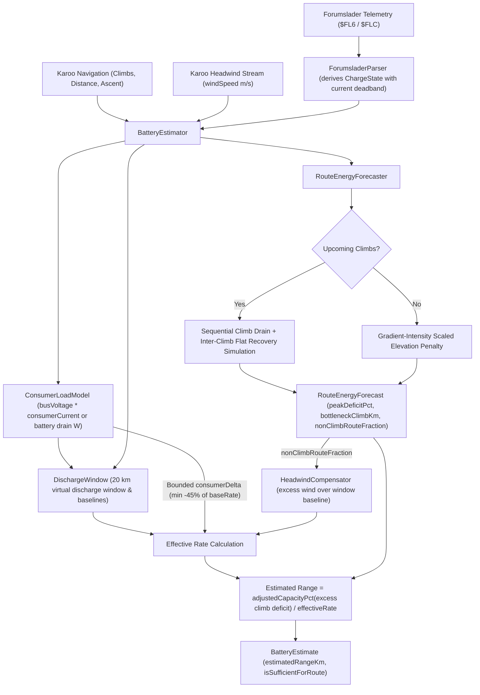
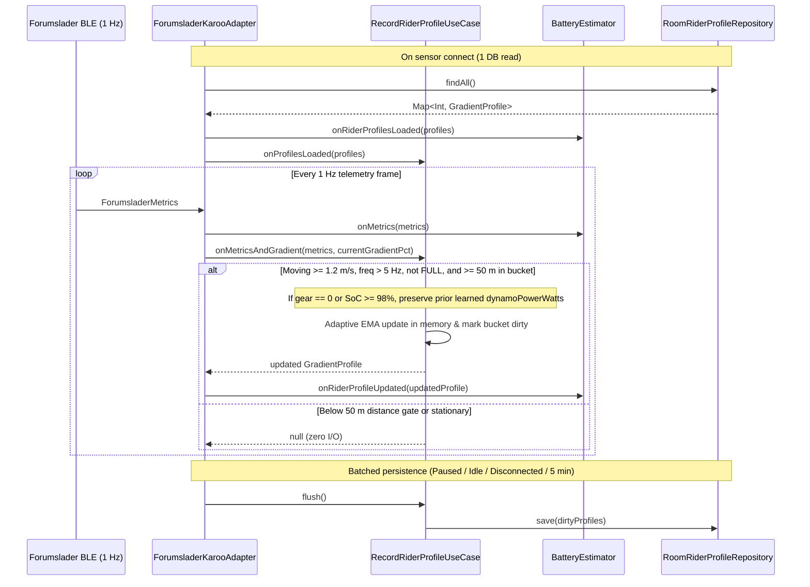

# Battery Range Estimation & Self-Learning Algorithm

This document describes how the Karoo Forumslader extension estimates remaining battery range,
evaluates route sufficiency, and learns a rider's climbing and dynamo power profile while minimizing
Karoo CPU and flash I/O overhead.

---

## 1. Design Philosophy & Architecture

The estimation subsystem lives inside `org.happycode.karoo.forumslader.domain.estimation` and
follows an object-oriented, single-responsibility design within the repository's onion architecture:

1. **Domain Layer (`domain/estimation`)** — Pure Kotlin models with zero Android or Room
   dependencies:
    - **`BatteryEstimator`**: Thin coordinator that receives telemetry, route updates, headwind
      updates, and learned profiles, and combines the four domain components into a
      `BatteryEstimate`.
    - **`DischargeWindow`**: Tracks virtual discharging distance (excluding charging phases), guards
      against integer-percentage voltage recovery bounces, smooths the base discharge rate via EMA,
      and computes windowed baselines for consumer load and headwind.
    - **`ConsumerLoadModel`**: Computes real consumer power draw in watts at battery bus voltage
      (capturing both 5 V USB and 12 V lighting loads) and converts live load shifts into bounded
      `%/km` adjustments.
    - **`HeadwindCompensator`**: Applies excess headwind penalty above the windowed baseline,
      weighted by the non-climb fraction of the remaining route.
    - **`RouteEnergyForecaster`**: Evaluates upcoming climbs and elevation gain, including dynamo
      recharge recovery on flat and descent gaps between climbs.
    - **`GradientProfile` & `DynamoPowerCurve`**: Store per-1%-gradient riding speed, dynamo
      frequency, and dynamo power output, with an adaptive sample-count EMA and speed-scaled
      headwind adjustments.
2. **Application Layer (`application/estimation`)**:
    - **`RecordRiderProfileUseCase`**: Learns `GradientProfile` buckets in memory using
      distance-gated updates (`50 m` per bucket) and flushes dirty buckets to persistence in
      batches.
3. **Extension / Persistence Layer (`extension/estimation`, `framework/persistence`)**:
    - **`ForumsladerKarooAdapter`**, **`RoomRiderProfileRepository`**, and **
      `SharedPrefsDischargeRateStore`**: Load saved profiles once on connect and persist updates
      only on ride state transitions, disconnect, or 5-minute intervals.

---

## 2. Object-Oriented Domain Model

```mermaid
classDiagram
    class BatteryEstimator {
        +onMetrics(metrics: ForumsladerMetrics)
        +onRouteRemaining(distanceMeters: Double?, upcomingElevation: Double?)
        +onUpcomingClimbs(climbs: List~ClimbSegment~)
        +onHeadwindSpeed(speedMs: Float?)
        +onRiderProfilesLoaded(profiles: Map~Int, GradientProfile~)
        +onRiderProfileUpdated(profile: GradientProfile)
        +getEstimate() BatteryEstimate?
    }

    class DischargeWindow {
        +lastDischargeRate: Float?
        +baselineConsumerPowerWatts: Float?
        +baselineHeadwindSpeedMs: Float?
        +recordSample(chargeState, batteryLevelPct, tripDistanceMeters, consumerPowerWatts, headwindSpeedMs)
        +reset()
    }

    class ConsumerLoadModel {
        +calculateConsumerPowerWatts(power: ForumsladerMetrics.Power) Float
        +calculateRateAdjustmentPctPerKm(currentPowerWatts, baselinePowerWatts, speedMetersPerSecond, baseRatePctPerKm) Float
    }

    class HeadwindCompensator {
        +calculateRatePenaltyPctPerKm(currentHeadwindMs, baselineHeadwindMs, nonClimbRouteFraction) Float
    }

    class RouteEnergyForecaster {
        +forecast(currentLevelPct, routeRemainingKm, upcomingElevationMeters, upcomingClimbs, riderProfiles, currentConsumerPowerWatts, headwindSpeedMs) RouteEnergyForecast
    }

    class RouteEnergyForecast {
        +peakDeficitPct: Float
        +bottleneckClimbKm: Float
        +nonClimbRouteFraction: Float
        +adjustedCapacityPct(currentLevelPct: Float, effectiveRatePctPerKm: Float) Float
    }

    class ClimbSegment {
        +startDistanceMeters: Double
        +lengthMeters: Double
        +gradientPct: Float
        +remainingFrom(distanceAlongRouteMeters: Double) ClimbSegment?
        +predictNetEnergyBalanceWh(profile, baseProfile, dynamoPowerCurve, consumerPowerWatts) Float
    }

    class GradientProfile {
        +gradientPct: Int
        +speedMetersPerSecond: Float
        +frequencyHz: Float
        +dynamoPowerWatts: Float
        +updatedWith(measuredSpeedMs, measuredFrequencyHz, measuredDynamoWatts: Float?) GradientProfile
        +adjustedForHeadwind(headwindSpeedMs: Float) GradientProfile
    }

    class DynamoPowerCurve {
        +predictPowerWatts(profile: GradientProfile, baseProfile: GradientProfile?) Float
        +predictFromFrequency(frequencyHz: Float) Float
    }

    class RecordRiderProfileUseCase {
        +onProfilesLoaded(profiles: Map~Int, GradientProfile~)
        +onMetricsAndGradient(metrics: ForumsladerMetrics, gradientPct: Float?) GradientProfile?
        +flush()
    }

    BatteryEstimator *-- DischargeWindow
    BatteryEstimator *-- ConsumerLoadModel
    BatteryEstimator *-- HeadwindCompensator
    BatteryEstimator *-- RouteEnergyForecaster
    BatteryEstimator o-- ClimbSegment
    BatteryEstimator o-- GradientProfile
    RouteEnergyForecaster ..> RouteEnergyForecast
    RouteEnergyForecaster ..> ClimbSegment
    RouteEnergyForecaster ..> GradientProfile
    RouteEnergyForecaster ..> DynamoPowerCurve
    ClimbSegment ..> DynamoPowerCurve
    ClimbSegment ..> GradientProfile
    RecordRiderProfileUseCase ..> GradientProfile
```

---

## 3. End-to-End Range Estimation Pipeline

Every telemetry frame (`$FL5`/`$FL6`/`$FLD` + `$FLC`), navigation update, and headwind stream event
feeds into the four domain calculators:

### Key Safeguards Against Unrealistic Swings

1. **Accurate `ChargeState` on Forumslader V5/V6 (`ForumsladerParser`)**:
    - Decodes the verified `$FL5`/`$FL6` status bitmask (`0x200 = STANDBY`, `0x100 = FULL`) and
      otherwise (ignoring `0x8000`) derives `ChargeState` from measured `batteryCurrent` outside a
      `±0.015 A` deadband (`> +0.015 A` → `CHARGING`, `< -0.015 A` → `DISCHARGING`, else `STANDBY`)
      so quiescent standby draw (e.g., `-4 mA`) does not report `DISCHARGING` and `DischargeWindow`
      tracks discharge distance and drops reliably.
2. **True 12 V & USB Consumer Power (`ConsumerLoadModel`)**:
    - `$FL6` `consumerCurrent` reflects battery-bus load (`batteryVoltage × consumerCurrent`, e.g.,
      `~12 V × 0.8 A ≈ 9.6 W` for a 12 V Supernova headlight + taillight via converter, rather than
      `5 V × I / 0.9`).
    - Negative consumer load deltas are capped at `-45%` of `baseRate` relative to the **windowed
      average** `baselineConsumerPowerWatts` (instead of a noisy 1-second snapshot), preventing a
      USB device disconnecting or turning lights off from clamping `effectiveRate` to `0.15 %/km`
      (600+ km spikes).
3. **Climb Bottleneck, Inter-Climb Recovery & Excess Deficit (`RouteEnergyForecaster`)**:
    - Rather than summing every upcoming climb over an entire 70–150 km route upfront with zero
      recovery, climbs are walked in route order:
        - Surplus dynamo power on flat/descent gaps (`0%` bucket output minus current consumer load,
          scaled by `0.70` for real-world stops/hysteresis) recharges the simulated battery up to
          `100%` before the next climb.
        - During night riding (e.g., `9.6 W` headlight load > `~4 W` flat dynamo output), recovery
          is `0`, so all night climbs properly accumulate.
        - `RouteEnergyForecast.adjustedCapacityPct(...)` deducts only the **excess** climb deficit
          above `bottleneckClimbKm × effectiveRatePctPerKm` so climb kilometers are never
          double-counted at night when dividing by `effectiveRate`.
    - When climb segments are unavailable and only `upcomingElevationMeters` is provided, routes
      with gentle average gradients (`< 3%`) scale the elevation penalty proportionally
      (`avgGrade / 3%`, min `0.25`) so long rolling tours do not double-count hills already
      reflected in the discharge rate.
4. **Proportional, Non-Double-Counted Headwind (`HeadwindCompensator` & `GradientProfile`)**:
    - Only excess headwind above `baselineHeadwindSpeedMs` (averaged across the discharge window) is
      added as a rate penalty, weighted by `nonClimbRouteFraction` so flat/rolling sections still
      respond smoothly even when a route contains distant climbs.
    - On climbs, `GradientProfile.adjustedForHeadwind` scales the aerodynamic speed reduction by
      `(speedMetersPerSecond / 5.0).coerceIn(0.35f, 1.2f)` so steep, slow climbs (`6–10 km/h`) are
      not unrealistically slowed below the dynamo cut-in threshold (`12 Hz`).

---

## 4. Self-Learning & Low-Power Persistence Lifecycle

To avoid 1 Hz SQLite read/write thrashing and extend Karoo battery life on overnighters, rider
profile learning is gated by distance and buffered in memory:

### Why Distance-Gated EMA Matters

- **Multi-Ride Memory Horizon**: Previously, `EMA_ALPHA = 0.1` applied at 1 Hz gave a 6.6-second
  half-life, overwriting 96% of learned history after 30 seconds on a climb. Now updates occur once
  per **`50 m`** traveled in a gradient bucket using a fixed `EMA_ALPHA = 0.05` (half-life ≈
  `700 m` per gradient bucket), providing consistent multi-ride stability across restarts with zero
  extra database state.
- **Full-Battery Hysteresis Cutoff Protection**: When the battery nears full (`SoC >= 98%`) or the
  Forumslader disconnects the generator (`generatorGear == 0`) during hysteresis coasting,
  `dynamoPowerWatts` reads `0 W` even at 25 km/h. `RecordRiderProfileUseCase` passes
  `measuredDynamoWatts = null` to `GradientProfile.updatedWith(...)` to preserve prior learned
  dynamo power, while genuine `0 W` readings below cut-in still blend downward normally.
  `DynamoPowerCurve` requires at least `0.25 W` before trusting a learned profile over the frequency
  curve.
- **Minimal Disk I/O**:
    - `RecordRiderProfileUseCase` keeps profiles in memory and flushes dirty buckets only on
      `RideState.Paused`, `RideState.Idle`, BLE disconnect, or every 5 minutes.
    - `CsvLogger` buffers rows in memory (`flushBatchSize = 20`) and tracks `cachedFileSizeBytes`
      and `hasHeader` in memory, flushing on pause/idle/disconnect/export instead of opening a file
      handle every second.

---

## 5. Black Forest Overnighter Walkthrough (3× 1.2 Ah Ahead V6, 13.3 Wh)

| Phase                              | Conditions                                                                                       | Old Algorithm Failure                                                                                                                                                  | New Algorithm Behavior                                                                                                                                                                              |
|------------------------------------|--------------------------------------------------------------------------------------------------|------------------------------------------------------------------------------------------------------------------------------------------------------------------------|-----------------------------------------------------------------------------------------------------------------------------------------------------------------------------------------------------|
| **Daytime Rolling / Climbing**     | `~1.0 W` baseline load, `4–10%` climbs (`6.5–12 km/h`) followed by descents/flats (`18–25 km/h`) | Inverted `$FL6` status bitmask misclassified discharging as `FULL` and `FULL` as `DISCHARGING`; all route climbs summed upfront with `0 W` hysteresis-polluted profiles | Corrected `$FL6` bitmask + `batteryCurrent` fallback; hysteresis `0 W` excluded; inter-climb recovery offsets earlier climbs so daytime range remains positive and sufficient (`✓`)                 |
| **Turning On 12 V Lights at Dusk** | Supernova E3 PURE 3 + Tail Light 2 (`~9.6 W` via `12 V` output, `0.8 A`)                         | Treated `consumerCurrent` as `5 V` (`4.4 W`, >2× underestimate); only reacted once 20 km window lagged behind                                                        | `ConsumerLoadModel` calculates `12 V × 0.8 A = 9.6 W`, immediately increases effective drain rate, and `RouteEnergyForecaster` disables inter-climb surplus recovery when `9.6 W > flatDynamoPower` |
| **Turning Off Lights / USB**       | Load drops from `9.6 W` back to `1.0 W`                                                          | Negative `consumerDelta` relative to 1-second baseline snapshot clamped `effectiveRate` to `0.15 %/km` → `600+ km` spike                                             | Windowed baseline + `-45%` negative delta floor keeps range transition smooth and realistic                                                                                                         |
| **Headwind on Mixed Route**        | `4 m/s` headwind with climbs remaining                                                           | Flat headwind penalty hard-zeroed (`0f`); climb speed linearly reduced (`1.8 → 0.8 m/s`) below dynamo cut-in                                                         | Excess headwind weighted by `nonClimbRouteFraction`; climb speed penalty scaled by `speed / 5.0 m/s`                                                                                                |
